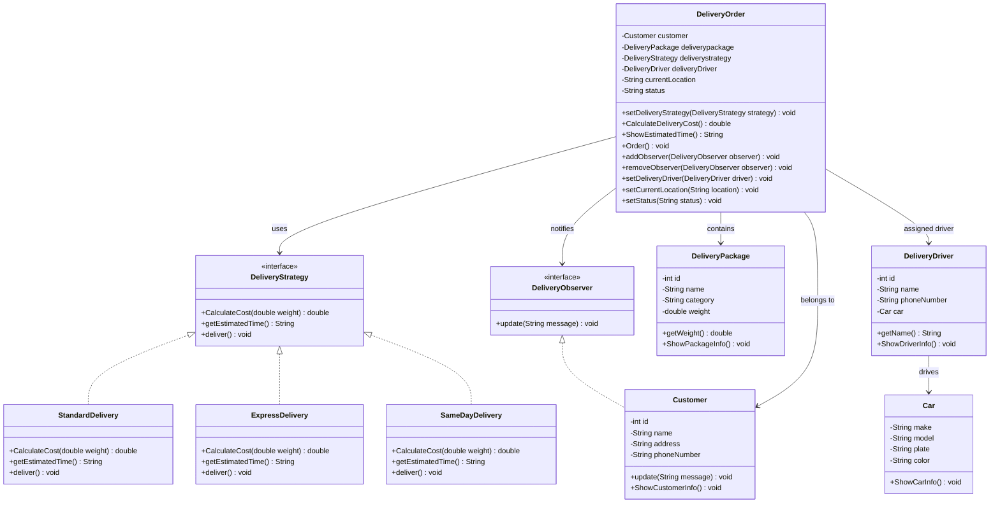

# Delivery System

A Java project that demonstrates the use of the Strategy Pattern and Observer Pattern.

## Design Patterns Used

### Strategy Pattern
The delivery method can be changed at runtime.

Implemented strategies:
- Standard Delivery
- Express Delivery
- Same Day Delivery

Each strategy defines:
- Delivery cost calculation
- Estimated delivery time
- Delivery behavior

### Observer Pattern
Customers are notified when delivery information changes.

Notifications can include:
- Delivery driver changes
- Package location changes
- Delivery status changes

## Main Classes

- `DeliveryOrder`
- `DeliveryPackage`
- `Customer`
- `DeliveryDriver`
- `Car`
- `DeliveryStrategy`
- `DeliveryObserver`

## Technologies

- Java
- IntelliJ IDEA
- Git
- GitHub

## Purpose

This project was created to practice object-oriented programming and design patterns in Java.

